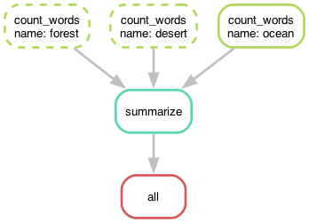
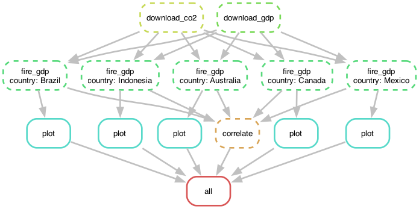

# Pipelines and workflows: Snakemake

Two parts:

1. `01_word_count/` is a toy pipeline that we build one idea at a time
   (`step1.smk` to `step5.smk`).
2. `02_fire_gdp/` takes Assignment 5 (forest fires vs. GDP) and turns the
   "Methods: include the commands someone would run" section into one
   command: `snakemake -c4`.

## Why a workflow manager?

At the end of Assignment 5 your README has something like this:

```
curl ... -o data/Agrofood_co2_emission.csv
curl ... -o data/IMF_GDP.csv
python src/get_fire_gdp.py --country Brazil ... > Brazil.tsv
python src/scatter.py Brazil.tsv Brazil.png ...
python src/get_fire_gdp.py --country Canada ... > Canada.tsv
python src/scatter.py Canada.tsv Canada.png ...
...
```

Some problems with that:

- Add a country and you copy and paste two more lines.
- Change `scatter.py` and you have to remember which steps to rerun.
- If one step fails halfway through, which files can you trust?
- Everything runs one step at a time, even steps that don't depend on each
  other.

A bash script solves the first problem. Snakemake solves all of them. You
describe how each file is made from other files. Snakemake works out the
order, skips anything that is already up to date, and runs independent steps
in parallel.

The core idea: **a rule turns input files into output files**. You ask
for an output, and Snakemake works backwards to find what it needs.

---

## Part 1: word count (`01_word_count/`)

Run everything from inside `01_word_count/`. Every step uses
`snakemake -s stepN.smk -c1`: `-s` picks the Snakefile and `-c1` allows one
core. Normally the file is just called `Snakefile` and you leave off `-s`.

### Step 1: one rule (`step1.smk`)

```
rule count_ocean:
    input:
        "data/ocean.txt"
    output:
        "counts/ocean.txt"
    shell:
        "wc -w < {input} > {output}"
```

Demo:

- `snakemake -s step1.smk -c1 -n` is a dry run. **Always do this first.**
- Run it for real, then run it again: "Nothing to be done".
- `rm counts/ocean.txt` and run again: it rebuilds.
- Point out that Snakemake made the `counts/` folder for us.

### Step 2: wildcards (`step2.smk`)

Replace `ocean` with `{name}`. The rule now works for any file.

- Running with no target fails. Snakemake can't guess which `{name}` you want.
- `snakemake -s step2.smk -c1 counts/forest.txt` works because Snakemake
  matches the target against `counts/{name}.txt`, which gives
  `name=forest`, which gives `data/forest.txt`.
- `counts/jungle.txt` fails with a "missing input" error. This is the
  working-backwards idea in action.

### Step 2b/2c: ambiguous wildcards (`step2b.smk`, `step2c.smk`)

In `step2b.smk`, `count_words` and `count_lines` both output
`counts/{name}.txt`. Running
`snakemake -s step2b.smk -c1 counts/forest.txt` raises
`AmbiguousRuleException` because either rule could make that file.
`step2c.smk` fixes it by giving each rule its own pattern
(`{name}.words.txt`, `{name}.lines.txt`). This is the same as the
`.data.txt` / `.rand.txt` example in the notes.

### Step 3: a target rule and `expand` (`step3.smk`)

```
NAMES = ["ocean", "forest", "desert"]

rule all:
    input:
        expand("counts/{name}.txt", name=NAMES)
```

- The first rule is the default target. By convention it is `all`, and it
  has inputs but no outputs or command.
- `expand` is plain Python. It returns a list of file names.
- Snakefiles are Python. You can put any Python above the rules.
- Change one input: `echo "Seals rest on the ice." >> data/ocean.txt` and
  rerun. Only ocean is redone. (In Snakemake 9 `touch` isn't enough, because
  it also checks whether the contents changed.)

### Step 4: chaining rules into a graph (`step4.smk`)

Add `summarize`, which needs all the count files.

```
snakemake -s step4.smk --dag | dot -Tpng > dag.png
```



- This is a DAG, a directed acyclic graph. Snakemake builds it from
  file names alone. We never said "run count_words before summarize".
- `glob_wildcards("data/{name}.txt").name` finds the inputs on disk. Add
  `data/tundra.txt` and it joins the pipeline with no code change.
- `-c3 --forceall` runs the three counts at the same time.

### Step 5: config, params, logs and our own script (`step5.smk`)

- `configfile: "config.yaml"` makes the settings available as `config["n_top"]`.
- `params:` holds values that aren't files.
- `log:` sends stderr to its own file for each job.
- The command calls `scripts/top_words.py`, an ordinary argparse script that
  follows the course's best practices. Snakemake just runs it.
- `--config n_top=5` overrides a setting from the command line.
- `--printshellcmds` (`-p`) shows the exact commands. That is your Methods
  section.

### Command cheat sheet

| Command | What it does |
|---|---|
| `-n` | dry run |
| `-p` | print shell commands |
| `-c N` | use up to N cores |
| `--forceall` / `-F` | rerun everything |
| `-f target` | rerun one target |
| `--dag \| dot -Tpng > dag.png` | draw the graph |
| `--config key=value` | override config |
| `--configfile other.yaml` | swap the whole config |
| `--summary` | show each file's status |

---

## Part 2: extending Assignment 5 (`02_fire_gdp/`)

> `src/fire_gdp.py` is a working solution to Assignment 5. Don't hand this
> folder out until the assignment is due.

Layout:

```
02_fire_gdp/
  Snakefile
  config.yaml          # real data: URLs, paths, list of countries
  config_test.yaml     # same pipeline on the tiny test/data files
  environment.yml
  src/
    fire_gdp.py        # get_data, get_column_index, get_fire_gdp_year_data
    get_fire_gdp.py    # command line: one country -> year, fire, gdp table
    scatter.py         # best-practice rewrite of the provided scatter.py
    correlate.py       # one Pearson r per country
  test/
    data/              # small committed CSVs (Brazil, Canada 2004-2006)
    unit/test_fire_gdp.py
    func/test_fire_gdp.sh
```

The pipeline:



### Walkthrough

1. **Download as a rule.** `download_co2` and `download_gdp` have outputs
   and no inputs. If `data/` is empty they run; otherwise they're skipped.
   This replaces "download the files in the README". Note that `data/` is
   still in `.gitignore`.
2. **One wildcard: `{country}`.** `fire_gdp` and `plot` each run once per
   country. `{wildcards.country}` passes the name to the script.
3. **The country list is config, not code.** Edit `config.yaml`, or try
   `snakemake -c1 --config countries='["Chile"]'`. The second command only
   computes Chile.
4. **Gather step.** `correlate` takes every table and writes one
   `results/correlations.tsv`. This matches the assignment's instruction to
   look at each country separately, since GDP is in local currency.
5. **Parallel.** Use `snakemake -c4`. The five countries are independent.
6. **Change a script.** Snakemake only tracks the shell string. It doesn't
   look inside `scatter.py`, so editing that script on its own wouldn't
   trigger a rerun. That's why each rule lists its script as an input
   (`script="src/scatter.py"`). Edit the axis label in `scatter.py`, run
   `snakemake -n`, and only the plots are redone. Without that, you'd force
   it with `snakemake -c4 -R plot`.
7. **Tests as a rule.** `snakemake -c1 test` runs the unit tests and then the
   ssshtest functional tests. A rule with no output always runs when you ask
   for it.
8. **Test the whole pipeline.** The last functional test runs
   `snakemake --configfile config_test.yaml` on the committed test data.
   It's the same Snakefile with a different config, so the test runs in about
   a second, needs no download, and can go in GitHub Actions.

   A bug I hit while writing this, and a good one to show the class:
   `--configfile` is *merged* on top of `config.yaml`, so the test still had
   the download URLs. Then `--forceall` reran `download_co2` with the
   output set to `test/data/co2.csv`, which overwrote the small test file
   with the full 7,000-line dataset. The fix is in two parts. The download
   rules are wrapped in `if config.get("co2_url"):`, and `config_test.yaml`
   sets the URLs to `""`. The lesson: a Snakefile is Python, and rules
   can be turned on or off by config.
